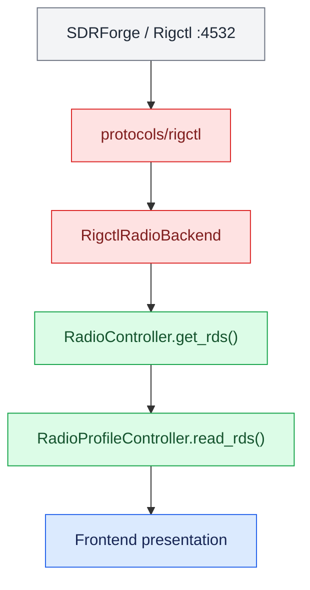

# Radio Controller

`controllers.radio` provides transport-independent radio behavior. It coordinates tuning, modes, presets, frequency ranges, selectable radio profiles, and radio-specific metadata without depending on a particular frontend.

## Package Layout

```text
controllers/radio/
├── radio_backend_if.py
├── radio_controller.py
├── radio_controller_if.py
├── radio_controller_stub.py
├── radio_input_adapter_if.py
├── radio_profile_controller.py
├── radio_profiles.py
├── radio_types.py
├── unconfigured_radio_controller.py
├── adapters/
│   ├── keyboard_radio_adapter.py
│   └── rigctl_radio_backend.py
├── component_test/
└── integration_test/
```

## Responsibilities

The package owns radio-domain behavior:

- Current frequency and demodulation mode
- Frequency stepping and configured range wrapping
- Preset selection and wraparound
- Config-driven radio profile selection
- Persistent user preset overlays
- Controller-facing backend contracts
- Input-to-controller mappings
- Adaptation of Rigctl to the radio backend contract
- Access to radio-specific metadata such as RDS when the backend supports it

Protocol packages own command formatting, socket communication, and response parsing. Native radio display controls and SDRForge transport adapters live in the radio controller layer. Frontends own presentation and user interaction.

ORC's compact FM dashboard and spectrum view share one receiver session.
Showing or hiding the plots changes presentation and spectrum polling while
preserving tuning and playback. MusicForge Trending uses its own read-only
[Airplay connection](../../docs/ethernet_idd.md#musicforge-airplay) and does not
open an RF receiver session.

## Radio Profiles

`RadioProfileCatalog` loads shipped profiles from `config/radio/common` and the configured locale directory, currently defaulting to `config/radio/romeo`. Locale profiles override common profiles with the same key.

User-created presets are stored separately from repository configuration so normal UI edits never mutate shipped JSON files.

`RadioProfileController` composes a `RadioController` for the active profile and provides profile/preset operations to frontends.

## RDS

RDS is radio metadata and belongs in the radio path and is published in SDRForge receiver telemetry.

The current ORC path is:

<div class="orc-diagram-legend" aria-label="Architecture diagram legend">
  <strong>Diagram key</strong>
  <span><i class="orc-legend-swatch orc-legend-app"></i>App / UI</span>
  <span><i class="orc-legend-swatch orc-legend-service"></i>Service / runtime</span>
  <span><i class="orc-legend-swatch orc-legend-controller"></i>Controller / domain</span>
  <span><i class="orc-legend-swatch orc-legend-message"></i>Messaging / contract</span>
  <span><i class="orc-legend-swatch orc-legend-adapter"></i>Protocol / hardware</span>
  <span><i class="orc-legend-swatch orc-legend-external"></i>External / input</span>
</div>



RDS should be requested asynchronously by graphical frontends. Reading ordinary controller state must not cause hidden network I/O.

ORC renders station identity and RadioText from receiver telemetry for WFM/FM profiles.

## SDRForge services

- 4532: Rigctl compatibility.
- 5570: REST receiver control and health.
- 5571: ZeroMQ spectrum and receiver telemetry.

See [RF radio contracts](../../docs/rf_radio.md).

## Basic Use

```python
from controllers.radio import RadioController, RadioMode, RadioPreset, RadioRange
from controllers.radio.adapters.rigctl_radio_backend import RigctlRadioBackend
from protocols.rigctl import RigctlClient

wide_fm = RadioMode(name="WFM", bandwidth=180_000, step_hz=100_000)

controller = RadioController(
    backend=RigctlRadioBackend(RigctlClient("127.0.0.1", 4532)),
    presets=[
        RadioPreset("88.7 FM", 88_700_000, wide_fm),
        RadioPreset("101.1 FM", 101_100_000, wide_fm),
    ],
    default_mode=wide_fm,
    radio_range=RadioRange(
        min_frequency_hz=87_500_000,
        max_frequency_hz=108_000_000,
        start_frequency_hz=88_100_000,
    ),
)

controller.start()
controller.frequency_up()
controller.next_preset()
controller.stop()
```

## Tests

Run the deterministic component test from the repository root:

```bash
python3 -m controllers.radio.component_test
```

Live receiver checks require a running SDRForge service. See the Rigctl protocol component tools for endpoint testing.

## Import Boundaries

Core users should depend on controller interfaces/types. Concrete transport adapters are imported explicitly:

```python
from controllers.radio.adapters.rigctl_radio_backend import RigctlRadioBackend
from controllers.radio.adapters.keyboard_radio_adapter import KeyboardRadioAdapter
```

This prevents optional transport dependencies from leaking into unrelated applications.

## Streaming Radio

`StreamingRadioBrowser` handles asynchronous directory discovery, stable favorite
identifiers, playback requests, artwork downloads, and stale completion rejection.
Frontends bind through `ui.radio.StreamingRadioUiIf`, render immutable browser
state, and emit semantic station-ID requests. Composition supplies the directory,
playback backend, favorites storage, worker schedulers, and frontend dispatcher.
Artwork uses a separate bounded worker pool so logos cannot delay playback.

`StreamingRadioController` owns serialized audio operations and immutable
playback snapshots. `StreamingRadioStateSourceIf` is the read-only Home contract;
reading a snapshot does not wait for native startup or shutdown. Hiding a browser
retires its callbacks and unstarted requests while existing audio continues.
Application shutdown uses terminal `close()` to stop audio and reject late starts.

Filter values and classification helpers live in `ui/radio/station_filters.py`.
`controllers.radio.streaming_radio_filters` retains compatibility reexports.
The migrated streaming path is covered by the strict UI type gate and import
boundary checks. RF profile/telemetry presentation remains a separate migration.
